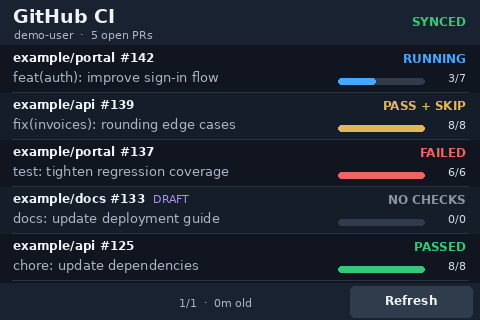
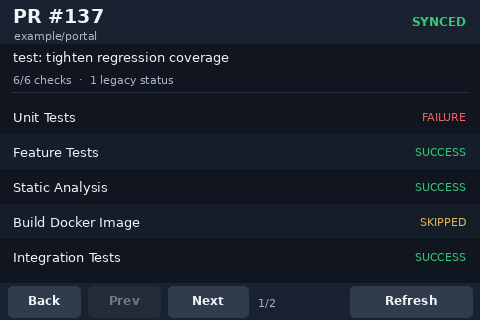

# GitHub CI Dashboard

A small, read-only GitHub pull request and CI monitor for a Raspberry Pi with a 3.5-inch SPI touchscreen. It draws directly to the Linux framebuffer using Pillow; **no desktop, browser, Docker, or cloned Git repositories** are required.

This is an archive of one working hardware-specific setup, not a general-purpose display framework.

## Previews

| Pull request list | PR check details |
| --- | --- |
|  |  |

The preview images use **fictional PRs and repositories**.

## Tested hardware and environment

- Raspberry Pi 3 Model B+, ARM64, Debian 13 (Trixie)
- 3.5-inch ILI9486 SPI TFT and XPT2046/ADS7846 resistive touch controller
- `/dev/fb0`: **480 × 320**, **16-bit RGB565**, **960-byte stride**
- Linux `ADS7846 Touchscreen` input device (automatically located by name)
- Python 3, `python3-pil`, `python3-evdev`, DejaVu fonts, and authenticated GitHub CLI `gh`

The framebuffer format and touch coordinates are hardcoded for this tested setup. Touch calibration is approximate. The framebuffer number may differ on other installations.

## Files

| File | Purpose |
| --- | --- |
| `touch_dashboard.py` | **The complete Python application**: GitHub API collection, framebuffer renderer, touch handling, PR details, refresh loop |
| `github-ci` | Optional shell command with `--minutes` argument |
| `assets/` | Fictional dashboard and detail screenshots for documentation |
| `.gitignore` | Excludes temporary files and local credentials by name |
| `README.md` | Installation and usage instructions |

## Install or restore

Install system dependencies on the Raspberry Pi:

```bash
sudo apt update
sudo apt install -y python3 python3-pil python3-evdev fonts-dejavu-core gh unzip
```

Authenticate the GitHub CLI under the **same Linux user** who will run the dashboard:

```bash
gh auth login
gh auth status
gh api user --jq '.login'
```

`gh` stores authentication outside the repository. Never copy tokens or `~/.config/gh/hosts.yml` into this project. Repository visibility and organization policies determine which PRs can be read.

To restore this ZIP to the expected project directory:

```bash
unzip github-ci-dashboard.zip -d ~
sudo install -m 755 ~/github-ci-dashboard/github-ci /usr/local/bin/github-ci
```

If you already have an older `~/github-ci-dashboard` directory, back it up before extracting. The archive is intended to contain the `github-ci-dashboard/` directory at its root.

## Run manually

From any directory:

```bash
github-ci                    # Fetch every 8 minutes
github-ci --minutes 5        # Fetch every 5 minutes
github-ci -m 10              # Fetch every 10 minutes
github-ci --help
```

Or launch the Python file directly from the project directory:

```bash
python3 -u touch_dashboard.py --interval 480
```

The Python `--interval` value is measured in **seconds**. The launcher `--minutes` argument is measured in **minutes**. The list rotates automatically every 8 seconds when it has multiple pages. Press **Ctrl+C** to exit and restore the previous framebuffer contents.

## Touchscreen controls

| Screen | Action | Result |
| --- | --- | --- |
| PR list | Tap a PR row | Open check and legacy-status details |
| PR list | Prev / Next | Move between list pages, when available |
| PR details | Back | Return to PR list |
| PR details | Prev / Next | Browse check details |
| Either | Refresh | Trigger an immediate GitHub API request, avoiding overlapping requests |

The UI displays open PRs authored by the currently authenticated GitHub account, including drafts. It shows completed check runs versus total check runs, rather than guessing execution-time percentages. It distinguishes pass, failure, pending/running, cancelled, skipped, and no-check conditions; legacy commit statuses are displayed separately.

GitHub requests are read-only. The collector uses the Search Issues/PRs API, Pull Requests API, Checks API, and commit status API through `gh api`. For a PR with no checks on its head commit, it also checks the reported merge commit. The search endpoint has a 1,000-result ceiling; this application reports that as an error rather than silently truncating results.

## Failure handling

- API work runs in a worker thread, leaving page and touch navigation responsive.
- On API failure, the last successful in-memory snapshot remains visible, and the status changes to **STALE**.
- Temporary failures trigger retry delays. The display is also considered stale if a successful update is more than the configured polling interval plus 2 minutes old.
- Manual Refresh is debounced and cannot start a second request while one is already running.
- The saved snapshot is **not** persisted across restarts.

## Troubleshooting

- **Framebuffer error:** Run `cat /proc/fb`, `ls -l /dev/fb*`, and `fbset -fb /dev/fb0 -i`. The code requires `/dev/fb0`, RGB565 at 480 × 320.
- **Permission denied:** The dashboard user needs read/write access to `/dev/fb0` and read access to the ADS7846 `/dev/input/event*` device. Check `id -nG` and the corresponding device permissions.
- **Touch controls inaccurate:** Adjust the `RAW_LEFT`, `RAW_RIGHT`, `RAW_TOP`, and `RAW_BOTTOM` constants near the top of `touch_dashboard.py`.
- **GitHub requests fail:** Check `gh auth status` and `gh api user --jq '.login'` as the same user running the dashboard.
- **No checks shown:** A PR may genuinely have no checks. The empty combined legacy status `pending` does **not** by itself mean CI is running.
- **Blinking cursor or black square:** The Linux console cursor may be overlaid on the framebuffer. You can hide it temporarily with `sudo sh -c 'printf "\033[?25l" > /dev/tty0'` and restore it with `sudo sh -c 'printf "\033[?25h" > /dev/tty0'`.

## Privacy and limitations

No personal GitHub user, organization name, repository, PR title, or access token is hardcoded in the packaged source or example images. Runtime data and console logs can naturally contain your real account and repository names; don't publish screenshots or logs without checking them.

If you create a Git repository, check **all staged files and Git author metadata** before pushing. A private repository is recommended for a personal hardware archive.

This implementation is not guaranteed to discover every check associated with every event type: if checks are split between head and synthetic merge commits, the collector currently selects one source, preferring head if it has checks. It also depends on GitHub permissions and API availability. The app is intentionally scoped to a known RGB565 framebuffer and ADS7846 controller.
